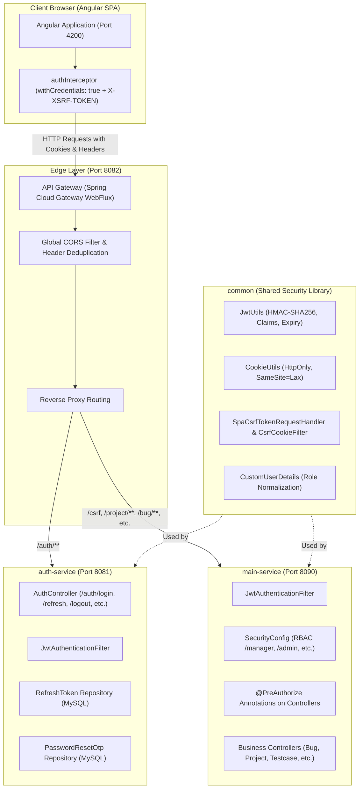

# Testing Lifecycle Automation Tool (TAT)
## Microservices Security Architecture & Inter-Service Specification

---

## 1. Executive Architecture Overview

The **Testing Lifecycle Automation Tool (TAT)** implements an enterprise-grade, defense-in-depth security model across its distributed microservices ecosystem. The architecture balances high throughput and low-latency microservice communication with zero-trust principles:

- **Decentralized Token Validation with Centralized Token Issuance**: Authentication is centralized in `auth-service`, while token validation is performed statelessly and locally in `main-service` using shared cryptographic primitives from the `common` library.
- **Pure HttpOnly Cookie Credentials**: Sensitive authentication tokens (`accessToken`, `refreshToken`) are never exposed to browser JavaScript, mitigating Cross-Site Scripting (XSS) credential theft.
- **Double-Submit Cookie CSRF Protection**: Cross-Site Request Forgery is mitigated using custom Spring Security 6 request handlers (`SpaCsrfTokenRequestHandler`) and deferred cookie evaluation (`CsrfCookieFilter`).
- **Edge Security & Header Normalization**: `api-gateway` enforces centralized Cross-Origin Resource Sharing (CORS), prevents browser CORS header duplication, and securely relays cookies across service boundaries.
- **Role-Based Access Control (RBAC)**: Fine-grained access control is enforced at both the HTTP endpoint layer and the Java method execution level using `@PreAuthorize`.



---

## 2. Microservice Security Breakdown

### 2.1. API Gateway (`api-gateway` — Port 8082)
The Gateway acts as the single public entry point for all external client traffic.

- **Technology**: Spring Cloud Gateway Server (Spring WebFlux / Netty).
- **Configuration Reference**: `api-gateway/src/main/resources/application.yml`
- **Key Responsibilities**:
  1. **Global CORS Enforcement**:
     - Explicitly whitelists approved client origins (`http://localhost:4200`, `http://192.168.3.97:4200`, etc.).
     - Enables `allowCredentials: true`, which is required for browsers to send and receive HttpOnly cookies.
     - Exposes critical security headers to the client: `Authorization`, `X-XSRF-TOKEN`, `X-CSRF-TOKEN`, and `Set-Cookie`.
  2. **Header Deduplication**:
     - `DedupeResponseHeader=Access-Control-Allow-Credentials Access-Control-Allow-Origin, RETAIN_FIRST` prevents browser runtime errors that occur if downstream services also set CORS response headers.
  3. **Transparent Cookie & Header Relay**:
     - Proxies client cookies (`accessToken`, `refreshToken`, `XSRF-TOKEN`) directly to downstream services without stripping or inspecting payload data.
  4. **Downstream Route Dispatching**:
     - `/auth/**` -> `auth-service` (port 8081)
     - `/csrf`, `/manager/**`, `/project/**`, `/features/**`, `/testcases/**`, `/bugs/**`, `/admin/**`, etc. -> `main-service` (port 8090)
     - `/api/v1/notifications/**` -> `notification-service` (port 8091)

---

### 2.2. Shared Security Library (`common`)
The `common` library provides reusable security utilities, classes, and handlers to guarantee behavioral consistency across all backend microservices.

- **Module Path**: `common/src/main/java/xyz/mobi/testingautomationtool/security`

| Class | Purpose | Technical Implementation |
| :--- | :--- | :--- |
| **`CookieUtils`** | Cookie serialization & parsing | Generates `ResponseCookie` with `httpOnly(true)`, `secure(false/true)`, `path("/")`, and `sameSite("Lax")`. Extracts cookies from `HttpServletRequest`. |
| **`JwtUtils`** | Cryptographic token operations | Signs and verifies tokens using HMAC-SHA256 (`Keys.hmacShaKeyFor`). Enforces dual-token model (`ACCESS` vs `REFRESH`). Computes remaining token lifespan. |
| **`CustomUserDetails`** | Principal representation | Implements Spring Security `UserDetails`. Extracts roles, prepends `ROLE_` prefix, and grants authorities for role-based evaluations. Checks `isEnabled()`. |
| **`SpaCsrfTokenRequestHandler`** | SPA CSRF Header Resolver | Extends `CsrfTokenRequestAttributeHandler`. Bypasses raw XOR decryption on incoming HTTP request headers (`X-XSRF-TOKEN`) while maintaining BREACH protection. |
| **`CsrfCookieFilter`** | Eager CSRF token evaluator | Extends `OncePerRequestFilter`. Forces evaluation of Spring Security 6 deferred tokens by invoking `csrfToken.getToken()`, ensuring the `XSRF-TOKEN` cookie is set. |

#### Dual Token Specification:
```
+---------------------------------------------------------------------------------------+
| ACCESS TOKEN (Lifespan: 15 Minutes / 900,000 ms)                                      |
| Claims: sub (username), tokenType: "ACCESS", userId, email, role, fullName, iat, exp  |
+---------------------------------------------------------------------------------------+
| REFRESH TOKEN (Lifespan: 24 Hours / 86,400,000 ms)                                    |
| Claims: sub (username), tokenType: "REFRESH", userId, iat, exp                        |
+---------------------------------------------------------------------------------------+
```

---

### 2.3. Identity & Authentication Provider (`auth-service` — Port 8081)
The `auth-service` is the sole microservice authorized to authenticate credentials and issue signed JWTs.

- **Key Files**:
  - `SecurityConfig.java`
  - `AuthController.java`
  - `AuthServiceImpl.java`

#### Key Endpoints and Mechanisms:
1. **User Registration (`POST /auth/register`)**:
   - Hashes passwords using `BCryptPasswordEncoder` (cost factor 10).
   - Initializes user in an inactive status (`isActive = false`) awaiting administrative approval.
2. **Authentication & Session Issuance (`POST /auth/login`)**:
   - Validates user credentials via Spring Security's `AuthenticationManager` (`DaoAuthenticationProvider`).
   - Rejects disabled/inactive accounts (`AccountDisabledException`).
   - Issues 15-minute `accessToken` and 24-hour `refreshToken`.
   - **Database Persistence**: Clears previous refresh tokens for the user in the `RefreshToken` table and stores the active token with an expiration timestamp.
   - **HttpOnly Cookie Headers**: Writes both tokens into `Set-Cookie` headers:
     ```http
     Set-Cookie: accessToken=eyJhbGciOi...; Max-Age=900; Path=/; HttpOnly; SameSite=Lax
     Set-Cookie: refreshToken=eyJhbGciOi...; Max-Age=86400; Path=/; HttpOnly; SameSite=Lax
     ```
3. **Session Refresh (`POST /auth/refresh`)**:
   - Reads the refresh token from either the `refreshToken` HttpOnly cookie or the JSON request body.
   - Performs a two-tier validation check:
     - **Cryptographic**: Verifies signature, expiry, and `tokenType == REFRESH`.
     - **Database State**: Verifies the token exists in the database, has not been revoked (`isRevoked == false`), and is not expired.
   - Issues a fresh 15-minute `accessToken` in a `Set-Cookie` header.
4. **Session Termination (`POST /auth/logout`)**:
   - Deletes the active refresh token from the database, revoking the session server-side.
   - Emits `Set-Cookie` with `Max-Age=0` to instruct the client browser to immediately destroy the cookie credentials.
5. **Two-Factor Password Recovery (OTP)**:
   - `POST /auth/forgot-password`: Generates a 6-digit cryptographically random OTP via `SecureRandom` (valid 5 minutes) and dispatches it via email.
   - `POST /auth/verify-otp`: Validates the code and exchanges it for a single-use UUID `resetToken` (valid 5 minutes).
   - `POST /auth/reset-password`: Consumes the `resetToken`, re-hashes the password with BCrypt, invalidates all existing refresh tokens, and auto-authenticates the user.

---

### 2.4. Business Core & Resource Server (`main-service` — Port 8090)
The `main-service` hosts all core business domains (Projects, Features, Test Cases, Bugs, Comments, Attachments, and Dashboards).

- **Key Files**:
  - `SecurityConfig.java`
  - `JwtAuthenticationFilter.java`
  - `JwtAuthenticationEntryPoint.java`
  - `CustomAccessDeniedHandler.java`

#### Security Design Highlights:
1. **Zero Network Hop Validation (Stateless)**:
   - `main-service` shares the identical HMAC-SHA256 secret (`app.jwt.secret`) with `auth-service`.
   - Incoming requests are validated in-memory inside `JwtAuthenticationFilter` in sub-millisecond time without making synchronous HTTP calls to `auth-service`.
2. **Dual-Extraction Strategy**:
   - Inspects `Authorization: Bearer <token>` header first (useful for Postman/CLI/integrations).
   - Falls back to reading `accessToken` from browser cookies via `CookieUtils.getAccessTokenFromCookies(request)`.
3. **Role-Based Access Control (RBAC)**:
   - **URL Pattern Rules**:
     - `/manager/**` -> `hasAnyRole('MANAGER', 'ADMIN')`
     - `/admin/**` -> `hasRole('ADMIN')`
     - `/bugs/**`, `/testcases/**`, `/features/**`, `/project/**` -> `hasAnyRole('MANAGER', 'TESTER', 'ADMIN', 'DEVELOPER')`
   - **Method-Level Security**:
     - Controllers use `@PreAuthorize("hasAnyRole(...)")` and `@PreAuthorize("hasRole('ADMIN')")` for fine-grained authorization.
4. **Standardized Error Payloads**:
   - Unauthenticated requests trigger `JwtAuthenticationEntryPoint`, producing standardized JSON:
     - `ERR_TOKEN_EXPIRED`: Informs the client that the 15-minute access token has expired and triggers transparent refresh.
     - `ERR_INVALID_TOKEN`: Informs the client that the token signature or claims are invalid.
   - Unauthorized requests trigger `CustomAccessDeniedHandler`, emitting `ER_0021` with HTTP 403 Forbidden.

---

### 2.5. Frontend Security Interceptor (`auth.interceptor.ts`)
The Angular application provides a zero-friction user experience while adhering strictly to HttpOnly cookie security:

- **Source Reference**: `testing-automation-frontend/src/app/core/interceptors/auth.interceptor.ts`
- **Key Behaviors**:
  1. **Automatic Cookie Propagation**: Clones all outgoing API requests with `withCredentials: true`.
  2. **CSRF Header Synchronization**: Reads the readable `XSRF-TOKEN` cookie (`httpOnly=false`) and populates the `X-XSRF-TOKEN` request header for non-safe HTTP methods.
  3. **Seamless 401 Interception & Auto-Refresh**:
     - Intercepts HTTP 401 responses on business endpoints.
     - Automatically fires `POST /auth/refresh` (the browser sends the HttpOnly `refreshToken` cookie).
     - Upon receiving new session cookies, transparently replays the original failed request.
     - If the refresh token has expired as well, clears local storage state and redirects to `/login`.

---

## 3. End-to-End Sequence Diagrams

### 3.1. User Authentication & Session Establishment
```mermaid
sequenceDiagram
    autonumber
    actor User as User Browser
    participant Gateway as API Gateway (8082)
    participant Auth as auth-service (8081)
    participant DB as MySQL Database

    User->>Gateway: POST /auth/login {username, password}
    Gateway->>Auth: Proxy /auth/login
    Auth->>DB: Query User by username or email
    DB-->>Auth: User record (passwordHash, role, active)
    Auth->>Auth: Verify BCrypt password & check active status
    Auth->>Auth: Generate 15m Access Token & 24h Refresh Token
    Auth->>DB: Delete old refresh tokens; Insert new RefreshToken record
    Auth-->>Gateway: HTTP 200 OK + Set-Cookie (accessToken, refreshToken HttpOnly; SameSite=Lax)
    Gateway-->>User: Forward response & Set-Cookie headers
    Note over User: Browser securely sets HttpOnly cookies
```

---

### 3.2. Business Request Execution (e.g. Fetching Bugs)
```mermaid
sequenceDiagram
    autonumber
    actor User as User Browser
    participant Interceptor as authInterceptor
    participant Gateway as API Gateway (8082)
    participant Main as main-service (8090)

    User->>Interceptor: Request: GET /bugs
    Interceptor->>Gateway: Forward with withCredentials=true + X-XSRF-TOKEN header
    Gateway->>Main: Proxy request with Cookie & Header payloads
    Main->>Main: CsrfFilter verifies X-XSRF-TOKEN matches cookie
    Main->>Main: JwtAuthenticationFilter extracts accessToken from cookie
    Main->>Main: JwtUtils validates HMAC-SHA256 signature & tokenType=ACCESS
    Main->>Main: CustomUserDetailsService loads role authorities (e.g. ROLE_TESTER)
    Main->>Main: SecurityContext populated; @PreAuthorize validates access
    Main-->>Gateway: HTTP 200 OK (Bug Data JSON)
    Gateway-->>User: Deliver HTTP 200 payload
```

---

### 3.3. Transparent Access Token Expiration & Silent Refresh
```mermaid
sequenceDiagram
    autonumber
    actor User as User Browser
    participant Interceptor as authInterceptor
    participant Gateway as API Gateway (8082)
    participant Main as main-service (8090)
    participant Auth as auth-service (8081)
    participant DB as MySQL Database

    User->>Gateway: GET /project/1 (accessToken cookie > 15 mins old)
    Gateway->>Main: Proxy request
    Main->>Main: JwtAuthenticationFilter detects ExpiredJwtException
    Main-->>Gateway: HTTP 401 Unauthorized {errorCode: "ERR_TOKEN_EXPIRED"}
    Gateway-->>Interceptor: HTTP 401 Unauthorized
    Note over Interceptor: Intercepts 401; initiates silent token refresh
    Interceptor->>Gateway: POST /auth/refresh (withCredentials: true sends refreshToken cookie)
    Gateway->>Auth: Proxy /auth/refresh
    Auth->>Auth: Validate refreshToken signature & tokenType=REFRESH
    Auth->>DB: Check RefreshToken in DB (isRevoked=false, not expired)
    Auth->>Auth: Generate new 15m accessToken
    Auth-->>Gateway: HTTP 200 OK + Set-Cookie (new accessToken)
    Gateway-->>Interceptor: HTTP 200 OK
    Note over Interceptor: Replays original GET /project/1 request
    Interceptor->>Gateway: GET /project/1 (with new accessToken cookie)
    Gateway->>Main: Proxy request
    Main-->>Gateway: HTTP 200 OK (Project Data)
    Gateway-->>User: Seamless response delivery without user disruption
```

---

## 4. Inter-Service Connection Matrix

| Security Feature | `api-gateway` (8082) | `auth-service` (8081) | `main-service` (8090) | `common` Library |
| :--- | :--- | :--- | :--- | :--- |
| **Primary Domain** | Edge reverse proxy & CORS | Identity lifecycle & token issuance | Resource authorization & business logic | Core cryptographic & security contracts |
| **Token Handling** | Relays cookies & headers | Generates dual tokens; validates refresh tokens | Statelessly validates access tokens | Defines signing, parsing, and claim keys |
| **Secret Key** | Not required | Reads `app.jwt.secret` | Reads identical `app.jwt.secret` | Implements HMAC-SHA256 signing |
| **State Storage** | Stateless (in-memory) | MySQL (`RefreshToken`, `PasswordResetOtp`) | Stateless (queries `User` table for roles) | Stateless |
| **CORS Policy** | Global WebFlux CORS filter | Disabled (delegated to gateway) | Disabled (delegated to gateway) | Shared OpenAPI config |
| **CSRF Handling** | Passes `XSRF-TOKEN` transparently | Cookie repository + `SpaCsrfTokenRequestHandler` | Cookie repository + `SpaCsrfTokenRequestHandler` | Implements handler & deferred filter |

---

## 5. Security Safeguards & Threat Mitigations

```
+-----------------------------+-----------------------------------------------------------------------------------------+
| Threat Vector               | Architectural Mitigation                                                                |
+-----------------------------+-----------------------------------------------------------------------------------------+
| XSS Credential Theft        | Tokens are stored in HttpOnly cookies; client-side scripts cannot access credentials.   |
| CSRF / Session Hijacking    | Double-Submit Cookie pattern enforced via SpaCsrfTokenRequestHandler & CsrfCookieFilter.|
| Token Replay / Long-Lived   | Access tokens expire in 15 minutes. Refresh tokens are tracked in DB and revokable.     |
| Cross-Origin Exploits       | Gateway restricts origins, credentials, and headers with deduplication filters.        |
| Inter-Service Latency       | Stateless JWT validation allows main-service to verify tokens without HTTP round-trips. |
| Privilege Escalation        | Multi-tiered RBAC enforced at both URL route pattern and Java @PreAuthorize levels.     |
+-----------------------------+-----------------------------------------------------------------------------------------+
```
